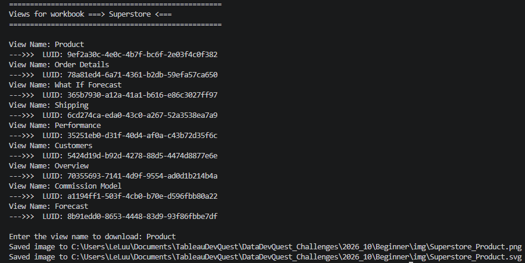
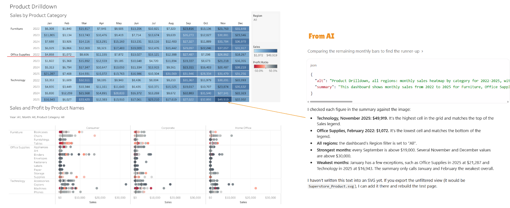
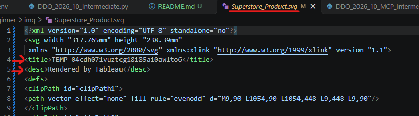
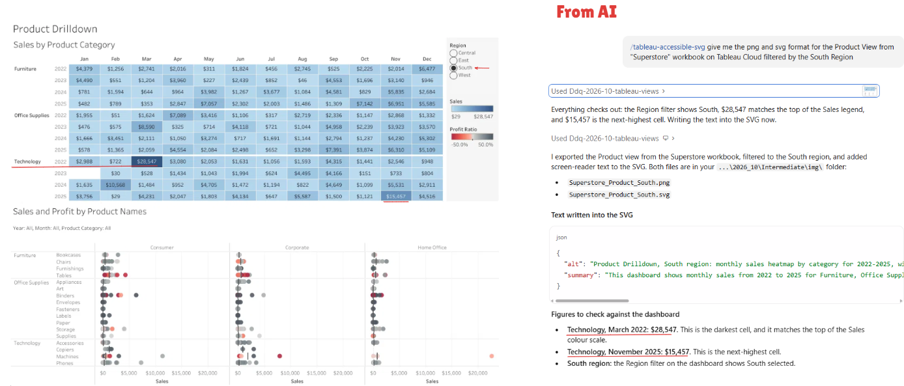
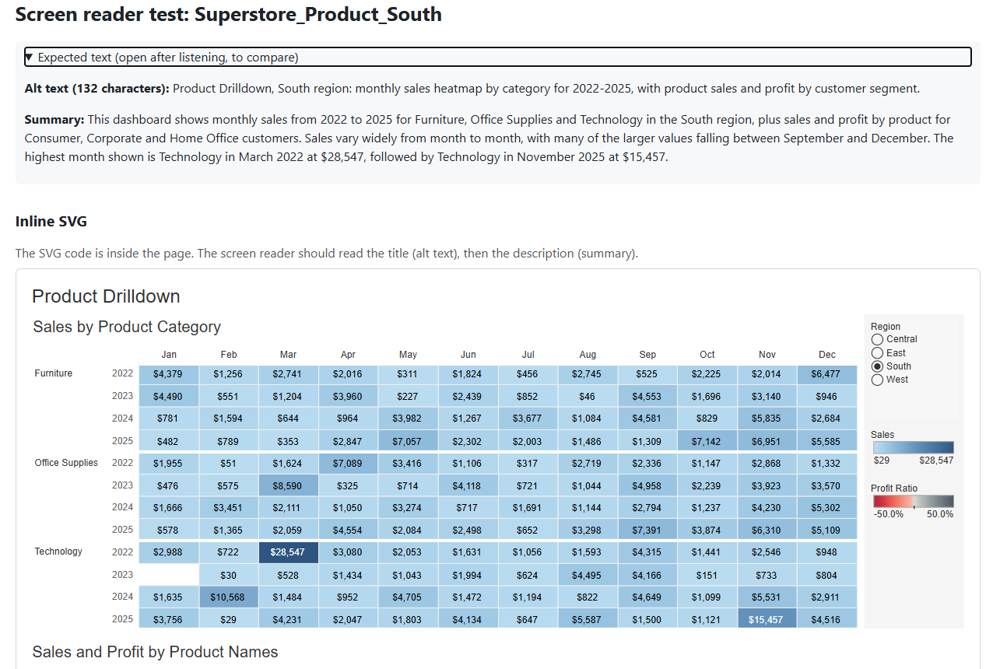

# DataDev Quest Challenge 2026_10


### Challenged By:

Pablo Gomez

### Solution Video

[](https://www.youtube.com/watch?v=n8_kODsYo20)

## Beginner Challenge

Link to the Beginner Challenge: https://datadevquest.com/challenges/ddq2026-10-describe-a-tableau-view-with-ai-beginner

### Objective

- Export the view in both PNG and SVG using REST API
- Ask AI to write alt Text and a short summary from PNG
- Export the view image with Tableau MCP in Claude Desktop and get the summary

### Output



I used Tableau Server Client with Tableau Metadata API to extract the metadata from workbook, views. Then, using Tableau REST API to download the custom view image to local machine in 2 formats (PNG and SVG).



Then, upload the png to Claude Desktop with a prompt:

> Write alt text under 150 characters and a three-sentence summary of this dashboard.
> Return JSON with the keys "alt" and "summary".

AI will return the insights from the image. Then, comparing them with the data on the image to ensure they're matched.



The PNG (Portable Network Graphics) image's size usually larger than SVG's size. The PNG image will loose the quality if zoom in too much while SVG can scale infinitely to any size. That's also in its name (SVG: Scalable Vector Graphics). From the image above, I opened the SVG with the text editor. From the top, it shows the format is in XML, the SVG tag shows the width and height. It also shows the title tag and desc tag which was rendered from Tableau.

## Intermediate Challenge

Link to the Intermediate Challenge: https://datadevquest.com/challenges/ddq2026-10-accessible-svg-exports-with-ai-intermediate

### Objective

- Export views as PNG and SVG with the REST API or TSC
- Filter an image export with view filters
- Prompt an AI model that can read images and get JSON back
- Edit an SVG safely with code, without touching the drawing
- Make an image accessible with <title>, <desc>, role, aria-labelledby and lang

### Output

After loading the custom MCP Server and the skill on Claude Desktop, typing the prompt in Claude Desktop as an MCP client.



In Claude Desktop, I used the skill **/tableau-accessible-svg** to extract the png and svg view image with the Product view from "Superstore" workbook on Tableau Cloud and filtered by the South region.

From the image above, I compared the insights from AI and the data from the image. They're matched.



I also asked Claude to generate an HTML page which can show the alt text and summary. Then, I can use the Screen Reader to read from the SVG image and compare with the text.

## Instructions

### Project Structure

```
DataDevQuest_2026_10/
├── Beginner/
│   └── DDQ_2026_10_Beginner_Solution.py     # Export a view as PNG + SVG with the REST API
├── Intermediate/
│   ├── DDQ_2026_10_Intermediate.py          # Helpers: sign in, export (with filters), edit SVG, build test pages
│   ├── DDQ_2026_10_MCP_Intermediate.py      # "Tableau View Tools" MCP server for Claude Desktop
│   ├── skills/tableau-accessible-svg.zip    # Claude skill: describe -> check -> ship an accessible SVG
│   └── accessibility_test/                  # HTML pages to test the SVGs with a screen reader
├── output_img/                              # Screenshots used in this README
├── pyproject.toml / uv.lock / requirements.txt
└── .env                                     # Your Tableau credentials (not committed)
```

### 1. Prerequisites

- **Python 3.13 or newer**
- **[uv](https://docs.astral.sh/uv/)** (recommended) or pip
- A **Tableau Cloud / Tableau Server** site with the **Superstore** sample workbook published
- A **Personal Access Token (PAT)**: in Tableau, open **My Account Settings → Personal Access Tokens** and create one. Copy the secret, because it's shown only once.
- **Claude Desktop** (Intermediate challenge only)

### 2. Clone the repository

Fork the repository and clone it to your local computer. Then open the Command Prompt (Windows) or Terminal (Mac) and change to the project folder:

```
git clone https://github.com/<your-username>/DataDevQuest_2026_10.git
cd DataDevQuest_2026_10
```

### 3. Set up the environment

**Option A: uv (recommended)**

```
uv sync
```

This creates a `.venv` folder and installs the exact versions in `uv.lock`.

**Option B: pip**

```
python -m venv .venv
```

Activate the virtual environment:

- Windows: `.venv\Scripts\activate`
- Mac/Linux: `source .venv/bin/activate`

Then install the packages:

```
pip install -r requirements.txt
```

### 4. Add your Tableau credentials

Create a file named `.env` in the project root (the same folder as `pyproject.toml`):

```
PAT_NAME=your_token_name
PAT_SECRET=your_token_secret
SERVER_ADDRESS=https://<your-pod>.online.tableau.com
SITE_ID=your_site_content_url
```

- `SERVER_ADDRESS` is the start of your Tableau URL, for example `https://10ax.online.tableau.com`.
- `SITE_ID` is the site name that appears after `/site/` in the URL. Leave it empty for the Default site on Tableau Server.
- `.env` is listed in `.gitignore`, so your secret is never committed.

### 5. Run the Beginner challenge

Run this from the project root, so the script can find `.env`:

```
uv run Beginner/DDQ_2026_10_Beginner_Solution.py
```

(With pip, activate `.venv` and run `python Beginner/DDQ_2026_10_Beginner_Solution.py`.)

The script lists the views in the **Superstore** workbook with their LUIDs and asks you to type a view name, for example `Product`. It saves `Superstore_<View>.png` and `Superstore_<View>.svg` to `Beginner/img/`.

Then upload the PNG to Claude with the prompt from the [Beginner Output](#output) section, and compare the JSON it returns with the image.

### 6. Run the Intermediate challenge

The Intermediate solution runs inside Claude Desktop. Claude uses a local MCP server to export the views and a skill to follow the describe → check → ship steps.

**a. Connect the MCP server to Claude Desktop**

Edit the config file from local machine, then check MCP tools on Claude Desktop in Settings -> Plugins -> Connectors

- Windows: `%APPDATA%\Claude\claude_desktop_config.json` (for example `C:\Users\<you>\AppData\Roaming\Claude\claude_desktop_config.json`). The `AppData` folder is hidden, so press `Win` + `R`, type `%APPDATA%\Claude`, press Enter, and open the file in a text editor such as Notepad or VS Code.
- Mac: `~/Library/Application Support/Claude/claude_desktop_config.json`

If the file doesn't exist, create it. Add the server under `mcpServers` and replace the paths with your own project folder. `command` is the Python inside the project's `.venv` (created in step 3), so the server runs with the installed packages:

```json
{
  "mcpServers": {
    "ddq-2026-10-tableau-views": {
      "command": "C:\\path\\to\\DataDevQuest_2026_10\\.venv\\Scripts\\python.exe",
      "args": [
        "C:\\path\\to\\DataDevQuest_2026_10\\Intermediate\\DDQ_2026_10_MCP_Intermediate.py"
      ]
    }
  }
}
```

- On Mac, use `.venv/bin/python` instead of `.venv\\Scripts\\python.exe`.
- In JSON, every `\` in a Windows path must be written as `\\`.
- If the file already has other servers, add this entry inside the existing `mcpServers` block and keep a comma between entries.
- The server reads `.env` from the project root, so you don't need to put your credentials in this file.

Fully quit Claude Desktop (also from the system tray) and reopen it. The server then appears under **Settings → Plugins → Connectors** and in the chat's tools menu as **Tableau View Tools**, with these tools:

| Tool                            | What it does                                                                                  |
| ------------------------------- | --------------------------------------------------------------------------------------------- |
| `list_workbooks`                | Lists the workbooks on your site                                                              |
| `list_views`                    | Lists the views (and LUIDs) in a workbook                                                     |
| `export_view_image`             | Exports a view as PNG + SVG, optionally filtered (for example `{"Region": "South"}`)          |
| `list_exported_images`          | Lists the files in `Intermediate/img/`                                                        |
| `view_png`                      | Shows an exported PNG to Claude                                                               |
| `add_svg_accessibility_text`    | Writes `<title>`, `<desc>`, `role="img"`, `aria-labelledby` and `lang` into the SVG with code |
| `build_screen_reader_test_page` | Builds the HTML test pages in `Intermediate/accessibility_test/`                              |

**b. Install the skill**

In Claude Desktop, make sure **Settings → Capabilities → Create and edit files** is on. Then upload `Intermediate/skills/tableau-accessible-svg.zip` in the **Skills** settings and turn it on. Start a **new** chat after you install it.

**c. Run it**

In a new chat, type a prompt like:

> /tableau-accessible-svg Export the Product view from the Superstore workbook filtered by Region = South, then make the SVG accessible.

Claude exports the PNG and SVG, writes the alt text and summary, checks the numbers against the image, and writes the text into the SVG.

**d. Test with a screen reader**

Ask Claude to build the screen reader test page, or open `Intermediate/accessibility_test/index.html` in Edge or Chrome. Turn on **Narrator** (`Ctrl` + `Win` + `Enter`) or **NVDA**. Listen to each chart and compare what you hear with the "Expected text" on the page.
